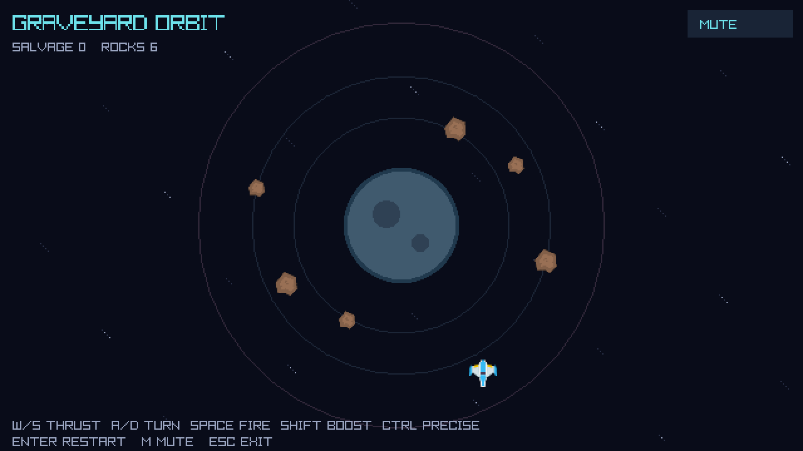

# Graveyard Orbit

A small, playable C# space shooter for reading unfamiliar code, branching, collaboration, feature development, and debugging. Built for students with basic OOP experience, working over a few days or weeks.

One ship. One gravitational planet. Six orbiting asteroids. Survive, shoot, and bring your own improvements.



## Quick start

Install the .NET 10 SDK (not only the runtime). From the repository root:

```bash
dotnet restore GraveyardOrbit.sln --locked-mode
dotnet build GraveyardOrbit.sln
dotnet test GraveyardOrbit.sln
dotnet run --project src/GraveyardOrbit.Game
```

The first restore needs internet access to NuGet. Asset paths are resolved from build output, not the terminal's working directory. The supplied SDK policy accepts installed .NET 10 feature bands; dependency versions and NuGet lock files are committed.

Windows: open GraveyardOrbit.sln in a Visual Studio installation supporting .NET 10, or open the repository folder in VS Code with C# tooling. Set GraveyardOrbit.Game as the startup project in Visual Studio. VS Code includes build/test tasks and an F5 launch configuration.

macOS: use VS Code and the .NET 10 SDK matching your CPU. Raylib-cs includes Intel and Apple Silicon native libraries. Linux: the packaged native library targets x64. Linux ARM64 and Windows ARM64 are not validated targets for this prototype and may need a separately built native raylib. Managed Box2D adds no native Box2D binary.

Linux requires a graphical session and an OpenGL-capable driver (or software renderer), plus the X11/OpenGL/audio shared libraries. On Ubuntu 24.04:

```bash
sudo apt-get install libgl1 libx11-6 libxcursor1 libxi6 libxrandr2 libxinerama1 libasound2t64
```

On Ubuntu 22.04, use libasound2 instead of libasound2t64. A native-load failure often means a missing shared library or a CPU mismatch. See VALIDATION.md for what has actually been tested.

## Controls and rules

| Input | Action |
| --- | --- |
| W / S | Forward / reverse thrust |
| A / D | Rotate left / right |
| Space | Fire, with a cooldown |
| Shift | Stronger thrust |
| Ctrl | Precision thrust (takes precedence over Shift) |
| Enter | Restart at any time |
| M / mouse mute button | Toggle sound |
| Mouse restart button | Restart after destruction |
| Esc | Exit |

The ship starts in an orbit, so releasing thrust does not stop it. A collision with the planet or an asteroid ends the run. Flying more than 9 metres from the planet also ends the run. Each destroyed asteroid yields 100 salvage points. Bullets expire after two seconds and never hit their owner. Clearing every asteroid shows a message; Enter starts a new run.

## Code map

| Location | Responsibility |
| --- | --- |
| src/GraveyardOrbit.Game/Program.cs | Window, lifetime, fixed-step loop, input, events, rendering |
| Game/Input | Keyboard translated into a small value object |
| Game/Simulation | Box2D adapter, level, bodies, gameplay and collision rules |
| Game/Assets | Manifest paths and cached GPU textures |
| Game/Audio | Audio device and minimal sound effects |
| Game/Rendering | Pixelated canvas, procedural planet, sprites, HUD |
| src/GraveyardOrbit.SpacePhysics | Newtonian gravity, thrust, circular-orbit initial velocity |
| tests/GraveyardOrbit.Tests | Focused xUnit examples, not exhaustive coverage |
| docs | Static GitHub Pages website: HTML, CSS, JavaScript |
| teaching | Code-reading route, exercises, review workflow and instructor notes |

The tracer bullet is executable: keyboard -> InputState -> GameSession -> custom forces -> Box2D -> contact events -> game events -> sprites and sounds. There is no ECS, dependency injection container, scene graph, or custom engine hidden underneath. Only the texture-loader seam is introduced to make resource ownership testable without a GPU.

Read teaching/ARCHITECTURE.md before changing simulation code and teaching/STUDENT_GUIDE.md for the collaboration workflow.

## Tests

```bash
dotnet test GraveyardOrbit.sln --filter "Category!=Native"
dotnet test GraveyardOrbit.sln --collect:"XPlat Code Coverage"
```

The first command skips the native raylib PNG-decoding smoke test. The normal suite includes it, without opening a window. Asset cache tests use a fake loader; Box2D tests use the actual managed library. There is no coverage threshold: students should decide which missing tests protect their own changes.

For a graphical smoke test (requires a display):

```bash
dotnet run --project src/GraveyardOrbit.Game -- --smoke-test
```

This runs 120 frames, synthesizes fire input, exercises texture loading and sound playback when available, and writes smoke.png in the working directory. It does not prove real keyboard/mouse usability or audio hardware output.

## Website and GitHub setup

The supplied repository is https://github.com/mscn-aarhustech/graveyard-orbit. No remote files or settings were changed by generating this starter. Copy the ZIP contents into your local clone and review any existing files before committing.

Enable Settings -> Pages -> Source: GitHub Actions. The included workflow publishes docs/ from main. Its intended address is https://mscn-aarhustech.github.io/graveyard-orbit/. The workflow deliberately does not deploy student forks automatically; students can remove its repository guard after configuring their own Pages deployment.

For a local website preview:

```bash
python3 -m http.server 8000 --directory docs
```

On Windows with the Python launcher, use py -m http.server 8000 --directory docs. Open http://localhost:8000. No Node packages or build step are required.

CI builds and runs sample tests on Windows, macOS, and Linux. Configure branch protection or a ruleset to require passing CI and peer review. Issue templates do not create actual issues; select tasks from teaching/BACKLOG.md and create them in GitHub.

## Licensing and AI assistance

Original code and documentation: standard MIT, see LICENSE. Kenney packs: CC0, with original licenses preserved. Dependency licenses: assets/THIRD-PARTY-NOTICES.md and THIRD_PARTY_LICENSES/.

AI-assisted coding is allowed. Contributors should disclose useful assistance and verify all changes. Licensing and AI-training policy discussion is a student task, not an extra restriction in the current license.
